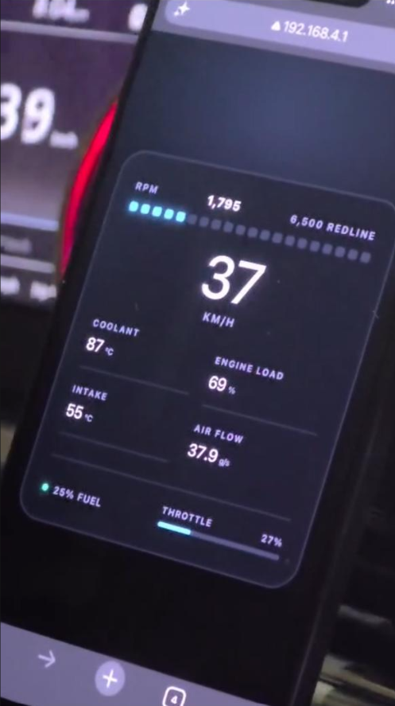
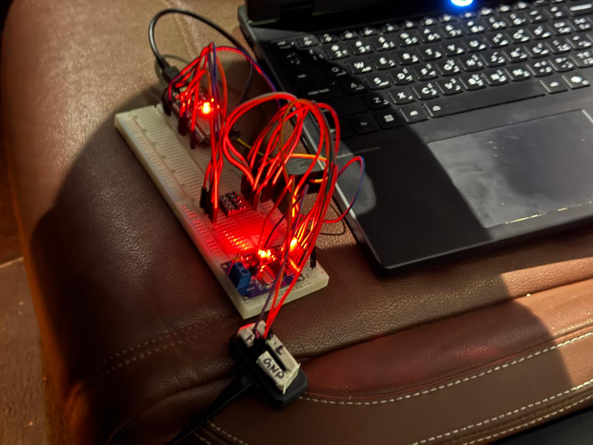
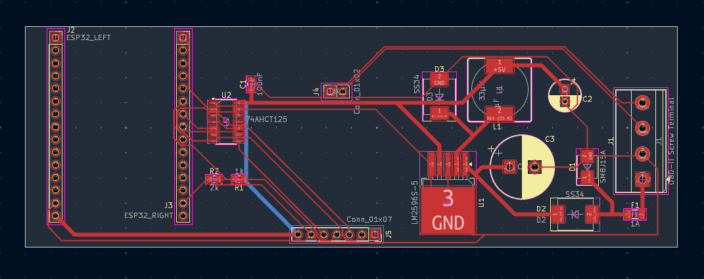
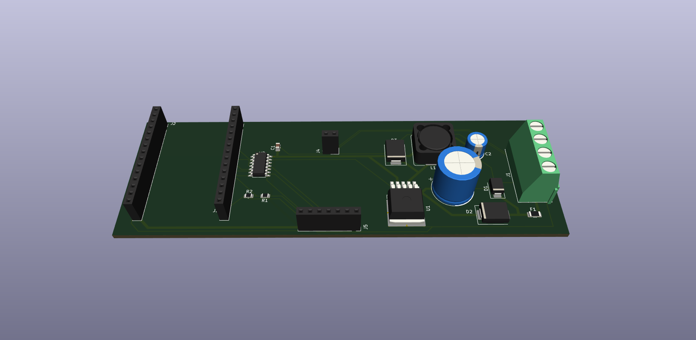
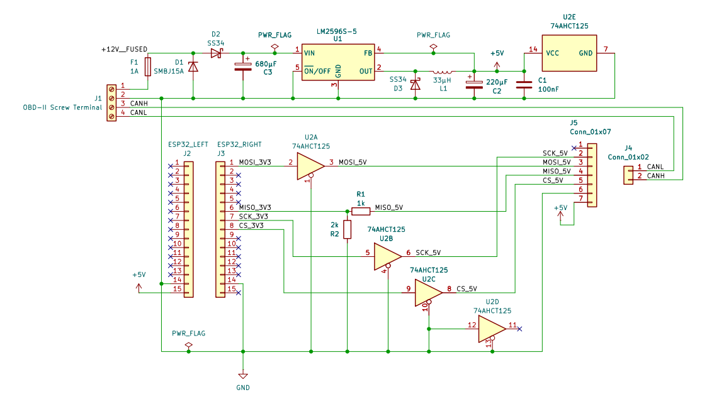

# ESP32 Car Telemetry Dashboard

An ESP32-based system that reads live engine data from my car's OBD-II port and shows it on a dashboard you open on a phone or tablet. This repo also includes a [KiCad design](#hardware) for a custom PCB that replaces my breadboard wiring.

Tested on: 2016 VW Touareg (3.6 V6 petrol)

<p align="center">
  
  
</p>

## What it does

- Connects to the car's CAN bus (ISO 15765-4, 500 kbit/s, 11-bit IDs) using an MCP2515 controller. It sends Mode 01 requests to `0x7DF` and reads the replies from `0x7E8`.
- Decodes the replies and shows RPM, speed, coolant temperature, intake air temperature, engine load and throttle position. Mass air flow, manifold pressure and fuel level are requested too, and they only show up if the ECU answers.
- The ESP32 runs its own Wi-Fi access point and a small web server. The dashboard page asks a JSON endpoint (`/data`) for new values every 150 ms.

## Built with

- **C++** on the ESP32, using the Arduino framework, written in VS Code with **PlatformIO**
- **[MCP_CAN_lib](https://github.com/coryjfowler/MCP_CAN_lib)** by coryjfowler, the library that talks to the MCP2515 over SPI to send and receive CAN messages (LGPL-3.0). `platformio.ini` pins the exact version I used
- The `WiFi` and `WebServer` libraries that come with the ESP32 Arduino core, for the access point and the web server
- HTML, CSS and a bit of JavaScript for the dashboard page, which is stored inside `interface.cpp`
- **KiCad 10** for the schematic and PCB

## Hardware

The breadboard version (ESP32 DevKit V1 + MCP2515 module) works in the car. The carrier PCB is a KiCad 10 design (2 layers, 130 × 44 mm) that plugs both boards into sockets and runs from the car's 12 V. **It is a design only, not fabricated or tested.** ERC and DRC report 0 errors and 0 warnings.

<p align="center">
  
  
</p>



- 12 V goes through a fuse, a TVS diode and a reverse-polarity diode into an LM2596S-5 buck regulator.
- A 74AHCT125 buffer handles the 3.3 V to 5 V SPI lines, with a resistor divider on MISO.
- Socket spacings are measured from my own boards, and the ESP32's USB and antenna ends hang over the board edge.

Files are in [`hardware/`](hardware): the [schematic PDF](hardware/vehicle-telemetry.pdf) and the [bill of materials](hardware/bom.csv).

## Run it

1. Copy `include/secrets.example.h` to `include/secrets.h` and put in your own Wi-Fi name and password (at least 8 characters). `secrets.h` is in `.gitignore`, so it stays off GitHub.
2. Plug in the ESP32 and upload with PlatformIO:

```
pio run --target upload
```

3. Join the Wi-Fi network from your phone and open `http://192.168.4.1`.

The Wi-Fi network uses WPA2 and allows 2 devices at a time. If PlatformIO picks the wrong serial port, add `upload_port = COM5` (use your own port) to `platformio.ini`.

## How the code is laid out

| File | What it does |
|---|---|
| `src/main.cpp` | `setup()` and `loop()`, joins the other parts together |
| `src/reader.cpp`, `include/reader.h` | `CANReader`: sends the OBD-II requests and decodes the replies |
| `src/interface.cpp`, `include/interface.h` | `WebInterface`: Wi-Fi access point, web server, dashboard page and JSON |
| `include/data.h` | `VehicleData`: the struct the reader fills in and the web server reads |
| `include/secrets.example.h` | template for the Wi-Fi name and password |

## Issues I faced

**Corrupted CAN data.** A cheap MOSFET level converter between the 3.3 V ESP32 and the 5 V MCP2515 module corrupted the SPI data. Loopback mode, which uses no car or cable, still showed the corruption, and wiring SPI directly gave clean data. The converter was most likely too slow for the SPI clock. I replaced it with a resistor-based voltage divider on MISO, and the PCB uses a 74AHCT125 for MOSI, SCK and CS.

**Unsupported data.** My car doesn't report gear, oil temperature or engine torque, so the dashboard doesn't show them. Requests the car never answers stay hidden.

## What I learned

I'm new to C++, and this project is where I learned:

- how to split a class between a `.h` file a `.cpp` file, basic C++ syntax
- using pointers and references
- working with raw bytes and hex: building an OBD-II request and decoding the replies with the standard formulas
- reading datasheets, and debugging hardware by testing one link at a time

## Future ideas

- Fabricate the board